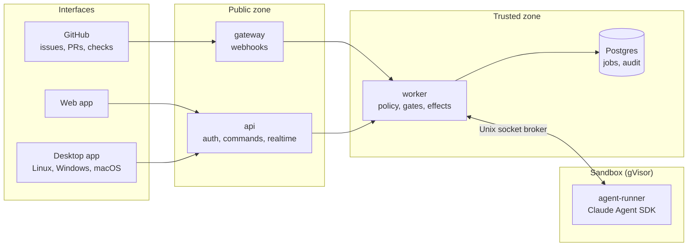

# Jules

**A self-hosted platform of AI development agents. Give it an issue, get back a reviewed pull request. No agent merges, no agent ever sees a secret, production always needs a human.**

-000?style=flat-square&logo=rust&logoColor=white)

> 🇫🇷 Architecture, workflow, roadmap and guides are written in French: [README.fr.md](./README.fr.md), [ARCHITECTURE.md](./ARCHITECTURE.md), [WORKFLOW.md](./WORKFLOW.md).

---

## Three agents

| Agent | What it does |
|---|---|
| 🧑‍💻 **Developer** | Takes a GitHub issue through a full SDLC cycle: **spec → design → tests first → implementation → automated gates → review by a second model**, then opens a draft PR ready for a human. `/jules fix` and "Request changes" loop back to it. |
| 🛠️ **DevOps** | Operates servers over SSH: diagnoses, proposes change plans, deploys from staging to production. Every command is classified by risk and approved by a human. |
| 🛡️ **Security** | Audits code, dependencies, images and servers, then tracks every finding until it is fixed. |

You drive Jules from **GitHub** (issues, PRs, checks), a **web app**, or a **desktop app** for Linux, Windows and macOS. All three send the same commands to the same engine.

## Why it can be trusted

Jules is built on one idea: **the agent has zero trust**. It can only ask; the worker decides and acts.

1. **Rules are code, not prompts.** Permissions, phase transitions and gates are evaluated by tested code. Anything not allowed is refused.
2. **Intent is separated from effect.** An agent tool records an intention (*"the build is ready"*, *"here is the change plan"*). The push, the PR or the server change is done by the worker, after checks.
3. **Deterministic first.** A model only reviews a diff that already passed build, lint, types, tests and scans. Security scanner findings are recorded without going through an LLM.
4. **No claim from the agent is believed.** Tests, coverage and scans are replayed by the worker in a fresh container, from the pushed commit.
5. **Config comes from the default branch,** never from the branch the agent is changing.
6. **All external content is data.** An issue, a comment, a repo file or a command output never gives Jules an order.
7. **Everything is bounded** (cost, time, iterations, review rounds) **and everything is traced** in a hash-chained audit log with no secret values.

### The sandbox

Each run gets a throwaway container under **gVisor** (`runsc`): non-root user, `--cap-drop=ALL`, `no-new-privileges`, read-only root, CPU, memory and PID limits, and an isolated network with no default route. The agent reaches the model through a per-run Unix socket broker, never with a key. The Docker socket is never mounted, and the worker never runs git on the host inside the agent's workspace, because a booby-trapped `.git/config` would execute code outside the sandbox.

## Architecture

| Layer | Stack |
|---|---|
| **Monorepo** | TypeScript strict, Node.js 24, pnpm + Turborepo, 5 apps and 18 packages (`policy`, `gates`, `sandbox`, `devops`, `security`, `audit`, `risk`…) |
| **Servers** | Fastify, zod, `@octokit/app`, Drizzle, pg-boss |
| **Agents** | `@anthropic-ai/claude-agent-sdk`, pinned |
| **Web** | React, Vite, TanStack Router and Query, Tailwind v4, passkeys (WebAuthn) |
| **Desktop** | Tauri 2 (Rust), OS keychain through `keyring` |
| **Gates & audits** | gitleaks, Semgrep, osv-scanner, Trivy, commitlint, diff coverage |
| **Tests** | Vitest, Testcontainers (real Postgres and Docker), Playwright |
| **Ops** | Docker Compose, Caddy or Cloudflare Tunnel, continuous Postgres backup with tested restores, OpenTelemetry |

## Status

Milestones **M0 to M11 are shipped**: the core (developer agent driven from GitHub), the web app, the DevOps and Security agents, the desktop app in connected and local modes, then hardening (continuous backup, tested upgrades, one-command install, Jules auditing itself, load tests). Version 1.0 will be tagged when its success criteria are met in real conditions, see [ROADMAP.md](./ROADMAP.md).

Jules is inspired by [Boubou](https://boubou.evolueoo.com/docs/architecture): it keeps its security model and adds an explicit SDLC workflow, deterministic gates, an independent review, risk-based autonomy and metrics. The differences are detailed in [ARCHITECTURE.md §22](./ARCHITECTURE.md).

## License

Copyright © 2026 Orlando R. All rights reserved. The source is published for review only, see [LICENSE](./LICENSE).
