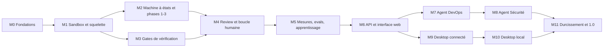

# Jules — Roadmap

> Statut : brouillon v0.3 — 27/10/2026
> Documents liés : [ARCHITECTURE.md](ARCHITECTURE.md), [WORKFLOW.md](WORKFLOW.md), [DESIGN.md](DESIGN.md)

## Vision

Jules 1.0 est une application complète :
- **trois agents** : développeur, DevOps et Sécurité ;
- **trois interfaces** : GitHub, le web, et le desktop pour Linux, Windows et macOS.

On la construit en trois étapes. Chaque étape livre quelque chose d'utilisable avant la suivante.

| Étape | Jalons | Résultat |
|---|---|---|
| 1. Noyau (MVP) | M0 à M5 | l'agent développeur, piloté depuis GitHub, sur tes repos |
| 2. Produit complet (1.0) | M6 à M11 | l'interface web, les agents DevOps et Sécurité, et l'app desktop en mode connecté et en mode local |
| 3. Extensions | après la 1.0 | environnements de preview, GitLab, autres sources de tâches, etc. |

Deux paires de jalons peuvent avancer en parallèle :
- M2 et M3, car les gates ne dépendent que du sandbox ;
- la branche desktop (M9, M10) et la branche agents (M7, M8).

**Règle** : un jalon ne commence que lorsque les jalons dont il dépend ont rempli leur Definition of Done.

La taille relative de chaque jalon (S, M, L) indique son effort estimé par rapport aux autres.

## Avant de commencer M0

Ces décisions et préparations ne demandent pas de code, mais M0 en a besoin.

| Élément | Pourquoi maintenant |
|---|---|
| Nom et licence : garder « Jules » (Google a un agent du même nom) ? propriétaire ou open source ? | le nom fixe le scope des packages dès M0, puis les identifiants de l'app desktop et le domaine |
| Hébergement du serveur : machine dédiée ou VPS Linux | M0 déploie déjà le gateway ; gVisor demande Linux |
| Compte Anthropic dédié à Jules, avec une limite de dépense dans la console | second filet derrière le budget du broker, dès M1 |
| Organisation GitHub et repo bac à sable | M0 et M1 s'y testent |
| 2 ou 3 repos pilotes, et 15 à 30 tâches historiques déjà mergées | jeu d'evals de M5 ; mieux vaut le constituer pendant le développement |
| Plus tard, avant M9 : comptes de signature Apple Developer et certificat Windows | délais de validation |

---

## Étape 1 — Noyau (MVP)

### Objectif

Sur un repo de test, puis sur 2 ou 3 de tes vrais repos : une issue `@jules` devient une PR prête pour la review humaine. Elle passe par la spec, la conception, le TDD, les gates déterministes et une review IA indépendante. Aucun secret n'entre jamais dans le sandbox.

### Critères de succès

- 20 tâches réelles traitées sur au moins 2 repos.
- Taux d'acceptation d'au moins 60 %.
- Aucun incident de sécurité.
- 100 % des PR avec une matrice de traçabilité complète (critère → tests).
- Suite de tests de sécurité verte (jalons M1 et M3).
- Coût moyen par PR mergée connu et suivi.

### M0 — Fondations (S)

> Statut (27/10/2026) : code livré et couvert par les tests automatisés de la DoD. Restent la création de la GitHub App, le premier déploiement et l'essai sur le repo bac à sable ([deploy/README.md](deploy/README.md)).

**Livrables**
- Monorepo pnpm + Turborepo, TypeScript strict, Vitest, et la CI du repo Jules (lint, types, tests).
- `CONTRIBUTING.md` : les règles du repo Jules lui-même.
  - Conventional Commits, un ADR par décision structurante, branche principale protégée, review obligatoire.
  - Couverture de 100 % sur `policy`, `workflow` et `risk`.
  - Dépendances épinglées et mises à jour par Renovate, scan osv-scanner.
  - SBOM et signature des images de sandbox.
  - Versions semver et changelog.
- `packages/db` : schéma et migrations ([ARCHITECTURE.md §14](ARCHITECTURE.md#14-données-postgresql)), avec un `org_id` sur chaque table. On ne crée que les tables du noyau ; les autres arrivent avec leur jalon.
- `packages/audit` : journal chaîné et vérification de la chaîne, avec des identifiants internes seulement ([ARCHITECTURE.md §18](ARCHITECTURE.md#18-données-personnelles-et-rétention)).
- `packages/secrets` : chiffrement enveloppe, clé maître hors de la base, procédure de copie de secours.
- La GitHub App, créée avec les permissions exactes (sans `workflows`) et installée sur un repo bac à sable.
- `apps/gateway` : vérification HMAC, déduplication, stockage des événements.
- La réconciliation des webhooks manqués ([ARCHITECTURE.md §17](ARCHITECTURE.md#17-fiabilité-et-exploitation)).
- `deploy/` :
  - docker compose (gateway, worker, postgres), exposé via Cloudflare Tunnel ou Caddy ;
  - sauvegarde quotidienne chiffrée hors de l'hôte.

**Definition of Done**
- Un commentaire `@jules` sur le repo bac à sable crée une tâche, et Jules répond par un commentaire de statut.
- Un webhook dont la signature est invalide, ou qui est rejoué, est rejeté (test automatisé).
- Un `@jules` envoyé pendant que le gateway est arrêté est rattrapé par la réconciliation au redémarrage (test).
- La modification d'une ligne de l'audit log est détectée (test automatisé).
- Une restauration depuis une sauvegarde redonne une base utilisable, secrets compris (test).

### M1 — Sandbox, broker et squelette de bout en bout (L)

> Statut (27/10/2026) : code livré. La DoD est couverte par des tests automatisés : le vrai binaire Claude Code tourne dans le sandbox face à un faux fournisseur de modèle. Les tests tournent avec `runc` sur la machine de développement. Restent l'essai avec gVisor sur le serveur et le refus d'un push de workflow par GitHub, sur le vrai GitHub (côté Jules, ce push est déjà refusé par la policy).

**Livrables**
- `packages/sandbox` : conteneurs gVisor durcis ([ARCHITECTURE.md §8](ARCHITECTURE.md#8-sandbox)), un réseau interne par exécution, destruction garantie.
- L'egress proxy avec son allowlist.
- Le broker :
  - `/capabilities/:name` : jeton d'exécution, validation zod, limites, audit ;
  - `/model/*` : proxy, comptage des tokens, budget, masquage.
- `packages/policy` v1 et les outils toujours refusés.
- `packages/agent-runner` : Agent SDK et serveur MCP `jules`.
- `packages/forge`, implémentation GitHub : clone et push avec garde-fous, PR brouillon, export des commits par `git bundle`.
- La table `outbox` : tous les effets (commentaires, push, PR) passent par elle, avec une clé d'idempotence.
- L'arrêt d'urgence en ligne de commande (`jules stop --all`).
- La résilience face au fournisseur de modèle : nouvelles tentatives, état `waiting_provider`, modèle de secours.
- Une seule phase, volontairement naïve : issue → développeur → push → PR brouillon.

**Definition of Done**
- Une issue simple sur le repo bac à sable donne une PR brouillon correcte.
- Les tests de sécurité automatisés sont tous verts :
  - aucune variable d'environnement ni aucun fichier du conteneur ne contient de jeton GitHub ou de clé API ;
  - depuis le sandbox, `curl https://example.com` échoue alors que `npm install` réussit ;
  - le sandbox ne joint ni Postgres, ni le gateway, ni l'hôte ;
  - un push vers `main` ou un force-push est refusé et journalisé ;
  - un push qui modifie `.github/workflows/` est refusé par GitHub ;
  - un `.git/config` piégé dans le workspace n'exécute rien sur l'hôte ;
  - les outils pièges sont refusés et journalisés ;
  - quand le budget est atteint, l'exécution est coupée.
- Les tests de fiabilité sont verts :
  - si le worker est tué au milieu d'une tâche puis redémarré, il ne produit ni commentaire en double, ni deuxième PR, ni effet perdu ;
  - `jules stop --all` arrête toutes les exécutions en moins de 10 s et révoque leurs jetons ;
  - une panne simulée de l'API modèle met la tâche en `waiting_provider`, puis elle reprend seule.

### M2 — Machine à états, phases 1 à 3, gates humaines (M)

> Statut (27/10/2026) : code livré. Les quatre critères de la DoD sont des tests automatisés qui passent avec le vrai sandbox. Après la build, la tâche s'arrête en `verifying`, avec la PR ouverte en brouillon ; les gates de M3 prennent la suite.

**Livrables**
- `packages/workflow` : états, transitions, gardes et transitions optimistes, avec des tests exhaustifs des transitions.
- Les rôles triager, specifier et architect, avec les schémas d'artefacts (`packages/artifacts`).
- Un commentaire de statut unique, édité à chaque transition.
- `packages/commands` et les commandes `/jules approve`, `revise`, `retry`, `budget`, `pause`, `resume` et `cancel`, avec le contrôle des permissions.
- `packages/risk` v1 (risque estimé), la voie rapide et les niveaux d'autonomie L0, L1 et L2.
- La langue des agents (`language` dans `.jules/config.yml`), en français par défaut.
- `/jules stop-all` depuis GitHub, réservé aux admins.

**Definition of Done**
- Une issue vague donne des questions, et aucun code.
- Une feature de risque `medium` :
  - publie sa spec et attend `/jules approve` ;
  - ignore la même commande venant d'une personne sans droit d'écriture.
- Une correction de coquille (`low`) suit la voie rapide jusqu'à la PR, sans attente.
- En L0, la tâche s'arrête après la conception.

### M3 — Gates de vérification (L)

> Statut (27/10/2026) : code livré. Les 8 PR piégées de la DoD sont bloquées par des tests automatisés, avec le vrai conteneur de vérification. Une PR propre passe ; la CI du projet est attendue, puis prise en compte ; un risque réel plus élevé redemande H2. G4.2 utilise un scanner intégré et G5.11 l'API OSV, plutôt que les binaires gitleaks et osv-scanner. G5.10 (Semgrep) et G5.12 (licences) restent à brancher : elles apparaissent en `skip` dans le rapport.

**Livrables**
- `packages/gates` et le conteneur de vérification, avec la config lue sur la branche par défaut.
- Les gates G4.x avant push et G5.1 à G5.14, publiées dans le check run `Jules / gates`.
- La boucle développement ↔ vérification, bornée.
- Le risque réel recalculé sur le diff, avec la gate H2 exigée si le risque dépasse ce qui a été approuvé.

**Definition of Done** : un jeu de PR piégées est entièrement bloqué. Chaque cas est un test automatisé :
- un secret dans le code ;
- une dépendance vulnérable ;
- un test supprimé ;
- un `.skip` ajouté ;
- un seuil de couverture abaissé dans la config de la branche (il doit être ignoré, car la config est lue sur `main`) ;
- un diff non couvert par les tests ;
- un bug corrigé sans test qui échoue sur la base ;
- un workflow de CI modifié.

### M4 — Review, traçabilité et boucle humaine (M)

> Statut (27/10/2026) : code livré. Une PR dont un critère manque est renvoyée en développement par le reviewer (test automatisé avec le vrai sandbox). La review est publiée en COMMENT avec ses commentaires en ligne, et la matrice de traçabilité est dans la PR. En L2, la PR passe en « ready ». `/jules fix`, « Request changes » et `@jules setup` sont couverts par des tests. Restent, sur le vrai GitHub : l'onboarding des repos pilotes et les 10 issues réelles.

**Livrables**
- Le rôle reviewer (autre modèle, contexte vierge) :
  - review de type `COMMENT` avec commentaires en ligne ;
  - check run `Jules / review` ;
  - rounds bornés.
- La description de PR avec la matrice de traçabilité.
- En L2 : passage de la PR en « ready » et demande des reviewers CODEOWNERS.
- La review humaine « Request changes » et `/jules fix`, qui relancent une itération sur la même branche.
- Les rulesets recommandés, documentés et appliqués sur les repos pilotes.
- `@jules setup` : onboarding d'un repo, qui produit une PR avec la config proposée, les CODEOWNERS et la liste des rulesets manquants.

**Definition of Done**
- Les repos pilotes ont été mis en place avec `@jules setup`.
- Le pipeline complet tourne sur 10 issues réelles d'un repo pilote.
- Une PR dont un critère n'est pas implémenté est renvoyée en développement par le reviewer.

### M5 — Mesures, evals et apprentissage (M)

> Statut (27/10/2026) : code livré. Un prompt candidat qui fait régresser le score de la suite est refusé par `jules eval compare` (test automatisé, avec le vrai sandbox). `jules report` donne le taux d'acceptation, le coût par PR mergée et les gates au premier essai. Le learner propose des leçons, un humain les valide avec `/jules lesson approve`, et elles sont injectées dans les tâches suivantes. La purge de rétention tourne chaque heure, et les traces OpenTelemetry partent dès que `OTEL_EXPORTER_OTLP_ENDPOINT` est défini. Restent : la vraie suite de 15 à 30 tâches tirées de tes repos ([evals/README.md](evals/README.md)), et la mesure des défauts échappés.

**Livrables**
- Les traces OpenTelemetry et les métriques ([WORKFLOW.md §10](WORKFLOW.md#10-métriques-et-promotion-dautonomie)).
- Un rapport hebdomadaire sous forme de commande `jules report` ; il passera dans l'interface web en M6.
- La suite d'evals (15 à 30 tâches historiques), avec son runner, son scoring et des prompts versionnés.
- Le rôle learner, les commandes `/jules lesson approve` et `reject`, et l'injection des leçons approuvées dans le contexte.
- La purge automatique selon les durées de conservation ([ARCHITECTURE.md §18](ARCHITECTURE.md#18-données-personnelles-et-rétention)).

**Definition of Done**
- Un changement de prompt est évalué avant déploiement, et refusé s'il fait régresser le score.
- Le rapport donne le taux d'acceptation, le coût par PR mergée et le taux de gates au premier essai.

### Pilote du noyau

Après M5, le noyau est déployé en L1 sur 2 ou 3 repos de `MTONGASWARM`. Chaque repo passe en L2 séparément, selon la règle de promotion de [WORKFLOW.md §10](WORKFLOW.md#10-métriques-et-promotion-dautonomie). Le pilote continue pendant toute l'étape 2 : c'est lui qui fournit les données réelles des métriques et des evals.

---

## Étape 2 — Produit complet (1.0)

### Critères de succès de la 1.0

- Les trois agents tournent sur tes repos et tes serveurs depuis au moins un mois, sans incident de sécurité.
- Chaque fonction est utilisable depuis le web et le desktop, et les fonctions du noyau le restent depuis GitHub.
- L'app desktop s'installe et se met à jour sur Linux, Windows et macOS, en mode connecté et en mode local.
- Tous les tests de sécurité sont verts, en mode serveur et en mode local.
- Les métriques DORA et Sécurité sont mesurées ([WORKFLOW.md §12.3 et §13.3](WORKFLOW.md#12-workflow-de-lagent-devops)).

### M6 — API et interface web (L)

**Livrables**
- `apps/api` :
  - connexion GitHub OAuth, sessions, rôles Jules ;
  - passkeys (WebAuthn) exigées pour les actions sensibles ;
  - REST versionné (`/v1`) et temps réel (SSE) ;
  - secrets en écriture seule (sealed box).
- `packages/commands` branché sur l'api : les boutons et les commandes GitHub passent par le même code.
- `packages/ui` et `apps/web` ([ARCHITECTURE.md §4.6](ARCHITECTURE.md#46-interface-web-appsweb)) :
  - tableau de bord ;
  - page tâche (chronologie, artefacts, diff, gates, review, coût, transcriptions masquées) ;
  - file d'approbations ;
  - réglages ;
  - audit, métriques, résultats des evals.
- Création de tâche depuis le web, qui crée l'issue GitHub.
- Le système de design de [DESIGN.md](DESIGN.md) : tokens du skill `warm-dark-ui`, thèmes sombre et clair, composants propres à Jules.
- L'interface en français et en anglais.
- Le bouton d'arrêt d'urgence.

**Definition of Done**
- Une tâche complète se suit et se pilote entièrement depuis le web, et les mêmes actions restent possibles depuis GitHub.
- Une approbation donnée sur le web puis sur GitHub : la seconde est refusée proprement.
- Un `member` sans droit d'écriture sur le repo GitHub ne peut pas approuver (test).
- Un artefact qui contient du HTML ou du JavaScript ne l'exécute pas (test XSS).
- Les requêtes forgées depuis un autre site sont refusées (test CSRF).
- L'api ne peut pas relire un secret qu'elle a écrit (test).
- Une action sensible tentée avec une session valide mais sans passkey est refusée (test).
- Parcours principaux couverts par des tests Playwright.
- La checklist de [DESIGN.md §12](DESIGN.md#12-vérification) passe : captures à 1280 et 390 px, dans les deux thèmes, et contrastes vérifiés.

> Statut (27/10/2026) : code livré. Les critères de la DoD sont des tests automatisés : ceux de l'api (CSRF, secret scellé illisible, passkey exigée, `member` sans droit GitHub refusé) en Vitest sur un vrai PostgreSQL ; l'approbation web puis GitHub, refusée la seconde fois, dans le worker ; et 27 tests Playwright sur la vraie api et la SPA construite (parcours principaux, XSS, passkey par l'authentificateur virtuel de Chromium, secret jamais réaffiché, arrêt d'urgence, 16 captures de référence, axe-core sans violation, aucun défilement horizontal à 390 px). La CI rejoue ces parcours sans la comparaison pixel, qui dépend des polices du système : elle se fait sur la machine de référence. Restent, sur le vrai serveur : la connexion OAuth avec la GitHub App réelle et une passkey matérielle.

### M7 — Agent DevOps (L)

**Livrables**
- `packages/ssh` : connexions durcies, clé d'hôte épinglée, clé privée en mémoire le temps d'une connexion, `sudo -n`, délais.
- `packages/devops` :
  - classification des commandes par parseur shell ;
  - plans de changement exécutés par le worker ;
  - playbooks (paramètres typés, vérification, retour arrière) ;
  - pipeline de déploiement staging → production ([WORKFLOW.md §12](WORKFLOW.md#12-workflow-de-lagent-devops)).
- Les outils `server_*`, les niveaux D0 à D3, les approbations dans le web avec notifications.
- Le verrou par serveur et le journal des étapes de chaque plan (`interrupted` en cas d'arrêt du worker).
- L'option « quatre yeux » pour la production.
- Les pages serveurs, playbooks, historique des commandes et déploiements. L'enregistrement d'un serveur inclut la validation de sa clé d'hôte.
- Depuis GitHub ([ARCHITECTURE.md §12](ARCHITECTURE.md#12-intégration-github)) :
  - `@jules devops <demande>` et l'approbation des plans hors production ;
  - le statut des déploiements sur les commits et dans les PR (permission `deployments`).
- Les métriques DORA.

**Definition of Done**
- Un jeu de commandes piégées est correctement classé (test) :
  - `rm -rf /`, une commande obfusquée en base64, `curl … | sh`, une lecture de `.env`, `dd` vers un disque → `dangerous` ;
  - une commande inconnue → au moins `change`.
- Une action absente du plan approuvé est refusée et demande un nouveau plan.
- Si le worker est tué au milieu d'un plan, le plan passe en `interrupted` et aucune étape n'est relancée seule (test).
- Deux plans lancés en même temps sur le même serveur s'exécutent l'un après l'autre (test).
- L'approbation de la production depuis GitHub est refusée tant qu'un admin ne l'a pas activée (test).
- Un changement de clé d'hôte bloque le serveur.
- Un déploiement complet staging → production réussit sur un repo pilote, avec un retour arrière déclenché volontairement en staging.
- Aucune clé SSH n'apparaît dans le sandbox, les logs ou l'audit (test).

> Statut (27/10/2026) : code livré. Chaque critère de la DoD est un test automatisé, sur une vraie base, de vrais serveurs OpenSSH (`images/ssh-test`) et un vrai git : 288 commandes classées (dont tout le jeu piégé) avec 100 % de couverture de `packages/devops` ; une commande hors plan refusée avec la consigne d'en soumettre un nouveau, et un plan modifié après approbation jamais exécuté ; un vrai processus worker tué (SIGKILL) pendant l'étape 2 laisse le plan `interrupted`, sans relance ; deux workers qui se disputent un serveur passent l'un après l'autre ; l'approbation de la production depuis GitHub refusée tant que le réglage admin est coupé, et sans passkey sur le web ; une clé d'hôte changée bloque le serveur ; aucune clé dans le sandbox, les fichiers d'exécution, les journaux ou l'audit, même quand le serveur l'affiche. Le pipeline complet passe de bout en bout : PR mergée, CI verte, staging vérifié, production approuvée avec passkey, et un retour arrière volontaire en staging qui n'atteint jamais la production. Le flux GitHub (`@jules devops`, plan publié, `/jules approve`) tourne avec le vrai binaire Claude Code dans le sandbox. Écarts assumés : la clé privée reste en mémoire du worker (client `ssh2`) au lieu d'un ssh-agent ; le rapport final est rédigé par le worker à partir des sorties réelles, pas par l'agent ; `server_publish_file` répond « pas encore disponible » ; les fenêtres de déploiement ne sont pas encore configurables. Restent, sur l'infrastructure réelle : un déploiement staging → production sur un repo pilote.

### M8 — Agent Sécurité (M)

**Livrables**
- `packages/security` :
  - audits du code, des images, des serveurs et de la plateforme ;
  - résultats des scanners enregistrés directement en findings.
- Le cycle de vie des findings ([WORKFLOW.md §13](WORKFLOW.md#13-workflow-de-lagent-sécurité)) : échéances par sévérité, risque accepté avec échéance, faux positifs confirmés par un humain.
- Les audits planifiés (scheduler).
- La remédiation par le pipeline développeur ou par une demande DevOps.
- Le blocage des déploiements par les findings critiques et hauts.
- Le security reviewer en phase 6, pour les PR à risque `high`.
- La page findings et le tableau de bord sécurité.
- Sur GitHub, pour les repos privés : envoi des failles du code en SARIF (permission `security_events`) et issues `security` pour les failles critiques et hautes.

**Definition of Done**
- Sur un repo de test qui contient une faille connue, le cycle complet se déroule : un finding est créé, puis une tâche de remédiation, puis une PR, et le finding passe en `resolved` après un nouvel audit.
- Un finding `high` ouvert bloque le playbook `deploy` de sa cible.
- L'agent ne reçoit jamais une valeur secrète, même en auditant un serveur rempli de fichiers `.env` (test).
- Sur un repo public, aucune faille n'est publiée sur GitHub (test).

> Statut (27/10/2026) : code livré. Les quatre critères de la DoD sont des tests automatisés : le cycle complet tourne avec le vrai sandbox (audit d'un repo qui contient lodash 4.17.15, finding `high`, remédiation proposée par l'agent en S1, tâche développeur de type `security` avec H1 et H2, PR livrée par le vrai agent développeur, merge, nouvel audit qui passe le finding en `resolved` et ferme son issue `security`) ; un finding `high` ouvert bloque le pipeline et le playbook `deploy`, jusqu'à ce qu'un humain accepte le risque ; un serveur rempli de `.env` est audité sans qu'aucune valeur n'atteigne l'agent, les findings, l'historique, l'audit ou les journaux (le script n'extrait que des noms, sur le serveur) ; un repo public ne reçoit ni SARIF ni issue, et sa remédiation est refusée. `packages/security` est pur et couvert à 100 %. Écarts assumés : les scanners sont intégrés (secrets de G4.2, OSV de G5.11, règles d'infra Dockerfile et compose) au lieu de Semgrep, gitleaks et Trivy ; `audit_image` répond « pas encore disponible ». Restent, sur l'infrastructure réelle : l'envoi SARIF vers l'onglet Security d'un vrai repo privé.

### M9 — App desktop, mode connecté (M)

**Livrables**
- `apps/desktop` (Tauri 2), qui embarque `packages/ui`.
- La connexion à un serveur Jules : OAuth avec PKCE dans le navigateur du système, jeton rangé dans le trousseau.
- Les fonctions propres au desktop :
  - notifications natives ;
  - icône dans la barre système avec les approbations en attente ;
  - ouverture d'un diff ou d'un repo local dans l'éditeur.
- Les builds signés : Linux (AppImage, deb, rpm), Windows (MSI), macOS (dmg universel, notarisé).
- Les mises à jour automatiques signées, et une CI de build sur les trois OS.
- Avant ce jalon : les comptes de signature (Apple Developer, certificat Windows).

**Definition of Done**
- L'installation et la connexion sont testées sur Ubuntu, Windows 11 et macOS (Apple Silicon et Intel).
- Une approbation DevOps peut être donnée depuis une notification.
- Une mise à jour publiée est installée automatiquement, et une mise à jour non signée est refusée.
- Un desktop trop ancien pour le serveur demande une mise à jour au lieu de se connecter (test).

> Statut (27/10/2026) : code livré ; construit sous Linux, pas encore installé. `apps/desktop` contient le shell Tauri 2 (trousseau, connexion OAuth avec PKCE sur une adresse de bouclage, notifications natives, barre système, ouverture dans l'éditeur, mises à jour signées) et la CI de build et de publication sur les trois OS. Testé ici : l'échange du code avec PKCE côté api (code à usage unique, vérificateur faux refusé, redirection hors bouclage refusée, CORS limité à la webview) ; le cœur Rust (`apps/desktop/core`, `cargo test` : PKCE avec le vecteur de la RFC 7636, retour de l'OAuth, compatibilité de version, mise à jour non signée, modifiée ou signée par une autre clé refusée) ; et l'interface desktop dans un navigateur avec un pont simulé (un desktop trop ancien demande une mise à jour ; connexion par PKCE, notification native qui nomme l'environnement, puis approbation d'un plan DevOps depuis cette notification). Les actions sensibles se confirment par une passkey dans le navigateur du système (la webview n'en gère pas : vérifié avec WebKitGTK 2.52), sur une page `/stepup` du serveur liée à la session du desktop. Le shell compile sous Linux (Ubuntu 26.04) : `tauri build` produit l'AppImage, le deb et le rpm, sans les archives de mise à jour faute de clé de signature, et l'app démarre sans erreur. Il a fallu épingler deux plugins sur la version de leur paquet npm et déclarer `serde_json` ; la CI installe aussi les en-têtes de D-Bus et de libxdo. Le clic sur une notification est relié au retour de la fenêtre au premier plan, les notifications natives de bureau n'offrant pas d'action portable. Restent : les comptes de signature (Apple Developer, certificat Windows) et la clé des mises à jour, puis les installations sur Ubuntu, Windows 11 et macOS (Apple Silicon et Intel), et la mise à jour automatique sur une vraie publication.

### M10 — App desktop, mode local (L)

**Livrables**
- Le lancement et la supervision de la pile locale (worker, PostgreSQL, egress proxy) par Docker ou Podman, avec détection et aide à l'installation si aucun des deux n'est présent.
- La forge locale (`packages/forge`) : branches dans le repo local, écran de review dans l'app, merge par un bouton (action humaine).
- Les secrets rangés dans le trousseau du système et transmis au worker au démarrage.
- L'affichage du niveau d'isolation : gVisor sous Linux, VM de Docker Desktop sous macOS et Windows.
- Le passage d'un mode à l'autre sans réinstaller.

**Definition of Done**
- Le pipeline développeur complet tourne sur un dossier local, sans GitHub, sur les trois OS.
- Les tests de sécurité de M1 passent aussi en mode local, adaptés à chaque OS.
- Aucun secret n'est écrit en clair sur le disque (test).

> Statut (27/10/2026) : code livré, prouvé sous Linux ; le shell Tauri compile sous Linux (voir M9), mais le mode local n'a pas encore été essayé dans l'app construite, et rien n'a tourné sous macOS ni Windows. La forge locale (`@jules/forge/local`) implémente le port GitHub sur un dossier git et les tables `local_*` ; le push vers le dossier et le merge sont forcés sans hooks (un hook versionné par l'agent puis extrait ne s'exécute pas, contrôle à l'appui). Les questions de l'agent se répondent dans l'app (commande `answer`, revérifiée comme un commentaire), faute d'issue GitHub. Le merge est un bouton de l'app (effet `local.merge`, rôle maintainer), qui écrit ensuite un événement de PR mergée : le retour d'expérience suit sans cas à part. L'api a un mode local (bouclage, connexion par un secret du trousseau dont elle ne connaît que le hash, dossiers sous les racines autorisées), le worker aussi (`JULES_FORGE=local`, clé maître et accès au modèle remis une seule fois par le desktop, jamais dans l'environnement d'un conteneur ; l'accès au modèle, le jeton d'un abonnement Claude créé par `claude setup-token` pour un usage personnel ou une clé API, est saisi dans l'app et rangé dans le trousseau, sans passer par la base ni par une passkey ; le broker l'envoie comme le fait Claude Code, et une limite d'abonnement met la tâche en attente jusqu'à la reprise annoncée). Les actions sensibles s'y confirment dans une fenêtre native, puis par une signature Ed25519 d'une clé du trousseau que la page ne voit jamais : écart assumé à la passkey, documenté dans ARCHITECTURE.md §4.2. La pile est `deploy/local/compose.yaml` ; le cœur Rust du desktop détecte Docker ou Podman, calcule l'isolation (gVisor, VM, conteneur seul), sert la remise unique et prépare l'environnement de la pile (28 tests `cargo test`). L'interface propose le mode au premier lancement, affiche l'isolation en permanence, gère les dossiers et le merge, et change de mode sans réinstaller. Chaque critère de la DoD est un test automatisé : le pipeline complet (issue, spec approuvée, conception, TDD, gates, review, merge par le bouton, retour d'expérience) sur un dossier local avec le vrai binaire Claude Code dans le sandbox ; les tests de sécurité de M1 rejoués avec la forge locale ; et le balayage des fichiers d'exécution, du dossier (`.git` compris) et des fichiers de PostgreSQL (WAL compris), où ni la clé API, ni la clé maître, ni le jeton de remise n'apparaissent, alors qu'un texte témoin y est bien retrouvé. Plus deux parcours Playwright du desktop en mode local (vraie api, vrais dossiers). Écarts assumés : Podman est détecté, mais le pilote des sandboxes n'est vérifié qu'avec Docker ; le chemin des dossiers sous Windows suit la convention de Docker Desktop avec WSL 2 sans y avoir été essayé ; les images ne sont pas encore publiées (construites depuis le repo). Restent : essayer le mode local dans l'app construite sur Ubuntu (avec gVisor), macOS et Windows 11.

### M11 — Durcissement et version 1.0 (M)

**Livrables**
- Sauvegarde continue de PostgreSQL (restauration à un instant donné), en plus de la sauvegarde quotidienne de M0 ; exercice de reprise complet sur une machine neuve.
- Montées de version avec migrations testées.
- Installation du serveur en une commande (script et docker compose), avec un guide.
- Documentation utilisateur et administrateur.
- Audit de sécurité de Jules lui-même : par l'agent Sécurité, plus une revue externe ou un test d'intrusion.
- Tests de charge : plusieurs tâches et plusieurs serveurs en même temps.

**Definition of Done**
- Une restauration depuis une sauvegarde est testée.
- La montée de version depuis la version précédente se fait sans perte de données.
- Aucun finding critique ou haut n'est ouvert sur Jules.
- Les critères de succès de la 1.0 sont remplis.

> Statut (27/10/2026) : code livré ; la publication de la 1.0 attend ses critères de succès en conditions réelles. Chaque livrable est prouvé par un test automatisé. **Sauvegarde continue** : PostgreSQL archive ses WAL (au plus 5 minutes), `wal-push.sh` les envoie par restic toutes les 5 minutes, une copie physique s'ajoute chaque nuit à la copie logique ; `restore-pitr.sh` restaure dans un volume neuf à un instant donné, testé de bout en bout avec la vraie image, la vraie config PostgreSQL et un vrai dépôt restic (l'écriture d'avant l'instant est là, celle d'après non, un volume non vide est refusé). **Montées de version** : migration du noyau publié (M5) à la 1.0 avec des données réelles, sans perte (tâches, artefacts, leçons, secrets déchiffrables, chaîne d'audit intacte) ; un test refuse toute migration destructive non annoncée ; l'api, le gateway et le worker refusent de démarrer sur une base en retard ou plus récente que leur code ; `deploy/upgrade.sh` sauvegarde d'abord, migre moteur arrêté, puis vérifie. **Installation en une commande** : `deploy/install.sh` (vérification de l'hôte, gVisor exigé, secrets en mode 600, `.env`, images, démarrage, timers), testé avec un faux Docker, de même que `upgrade.sh`. **Documentation** : `docs/guide-utilisateur.md` et `docs/guide-admin.md`. **Audit de Jules par son agent Sécurité** (`jules audit self`) : 806 paquets vérifiés par la vraie API OSV, aucun finding critique ou haut ouvert ; l'audit a corrigé deux faux positifs du scanner de secrets (un nom de secret, un en-tête de clé en texte d'exemple) et une règle d'infra qu'une variable contournait ; les décisions humaines (faux positifs des tests, socket Docker du worker accepté jusqu'au 27/10/2027) sont versionnées dans `security/exceptions.json`. Restent ouverts trois findings moyens : deux images en root (sauvegarde, serveur SSH de test) et esbuild 0.18 (outil de développement). **Charge** : six tâches sur trois repos avec trois exécutions à la fois (vrai binaire Claude Code dans le sandbox), sans doublon ni effet perdu ; six plans sur trois serveurs OpenSSH et trois workers. Ce dernier test a trouvé un vrai défaut : la réservation verrouillait jusqu'à dix plans à la fois, si bien qu'un seul worker exécutait tout, serveur après serveur ; corrigé (un plan verrouillé par essai, plusieurs serveurs en parallèle par worker, toujours un plan à la fois par serveur) : 3,0 s au lieu de 6 s ou plus. Restent, hors du code : la revue externe ou le test d'intrusion, l'exercice de reprise sur une machine neuve avec les vraies sauvegardes, et les critères de succès de la 1.0 (un mois d'usage sans incident de sécurité, installations du desktop sur les trois OS).

---

## Étape 3 — Extensions (après la 1.0)

- Phase 7 du workflow : environnements de preview, tests Playwright, captures jointes aux PR.
- Reviewers spécialisés supplémentaires (migrations, performance).
- Support de GitLab.
- Intake depuis Linear, Trello ou Jira.
- Notifications externes (e-mail, Telegram, Slack).
- Images de sandbox construites depuis `devcontainer.json`.
- Recherche dans l'historique des tâches (pgvector).
- Commits signés.
- Plusieurs tâches en parallèle sur un même repo.
- Merge automatique des PR à faible risque, **seulement** si les métriques le justifient.

## Risques du projet

| Risque | Impact | Parade |
|---|---|---|
| Périmètre très large | la 1.0 n'arrive jamais | trois étapes livrables ; le noyau sert dès M5 ; une Definition of Done testable par jalon ; pas de jalon commencé avant ceux dont il dépend |
| Les modèles coûtent plus cher que prévu | budget | budget par tâche ; coût par PR mergée suivi dès M1 ; réglages d'effort testés avec les evals |
| L'Agent SDK évolue | l'agent-runner casse | version épinglée ; agent-runner isolé derrière une interface ; tests de contrat |
| Faux positifs des gates et des scanners | tâches bloquées, findings ignorés | seuils réglables par repo ; mode avertissement au démarrage ; faux positifs confirmés par un humain |
| Repos sans tests | gates de test inapplicables | G5.6 et G5.7 en avertissement ; tâche « mettre en place les tests » proposée en L0 |
| Fatigue d'approbation (DevOps) | approbations données sans lire | playbooks ; une approbation par plan ; commande exacte affichée ; nombre d'approbations suivi |
| Une erreur DevOps en production | panne | production toujours approuvée ; vérification et retour arrière obligatoires dans chaque plan ; staging avant production |
| Signature des apps desktop | coût annuel, délais de validation | comptes Apple Developer et certificat Windows ouverts avant M9 |
| Docker sur le poste des utilisateurs | installation pénible, surtout sous Windows | détection et aide à l'installation ; Podman en alternative |
| Isolation plus faible en mode local sous macOS et Windows | risque d'évasion plus élevé | niveau d'isolation affiché ; mode serveur recommandé pour les repos sensibles |
| Limites de l'API GitHub | ralentissements | jetons d'installation, ETags, appels regroupés |
| Évasion du sandbox | compromission de l'hôte | gVisor ; hôte dédié sans autres données ; mises à jour régulières |
| Trop de cérémonie | Jules trop lent pour les petites tâches | voie rapide ; niveaux d'autonomie |
