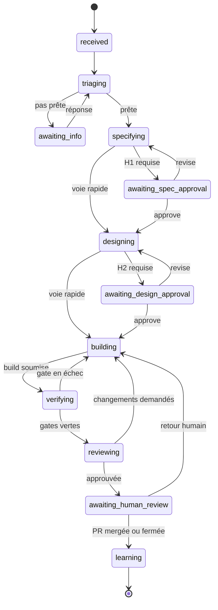
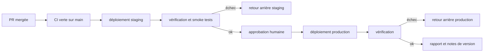
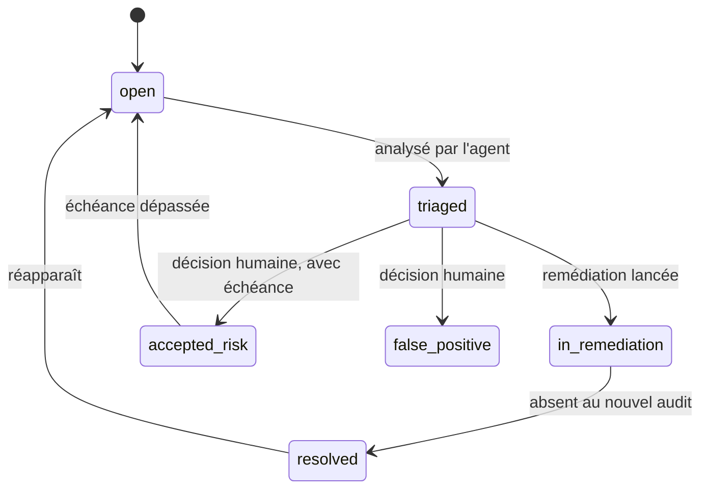

# Jules — Workflow SDLC

> Statut : brouillon v0.3 — 27/10/2026
> Documents liés : [ARCHITECTURE.md](ARCHITECTURE.md), [ROADMAP.md](ROADMAP.md)

Ce document décrit les cycles de travail des trois agents :
- **§1 à §11** : comment l'agent développeur transforme une issue en pull request. On y trouve les phases, ce que chaque phase produit, et les conditions (gates) pour passer à la suivante.
- **§12** : le cycle de l'agent DevOps (changements sur les serveurs et déploiements).
- **§13** : le cycle de l'agent Sécurité (audits et findings).

## 1. Principes

- **Chaque phase a un contrat** : un rôle, des entrées, un artefact typé, une gate de sortie et un budget.
- **Une gate est soit automatique, soit humaine.** Une gate automatique est du code déterministe. Une gate humaine est une commande d'une personne autorisée. Un LLM ne valide jamais son propre travail.
- **Les boucles de correction sont bornées.** Au-delà de la limite, la tâche passe en `blocked` et un humain décide.
- **Le niveau de cérémonie dépend du risque.** Une coquille dans la doc ne demande pas de valider une spec. Une migration de base, si.
- **Tout est traçable.** Chaque critère d'acceptation se retrouve dans un test, dans un commit et dans la PR.

## 2. Vue d'ensemble



Trois états de sortie sont possibles depuis n'importe quel état :
- `blocked` : une limite est atteinte (budget, itérations, rounds) ;
- `cancelled` : un humain a tapé `/jules cancel` ;
- `failed` : erreur système.

Les états `blocked` et `failed` attendent une commande humaine (`/jules retry` ou `/jules cancel`).

Les phases 2 et 3 peuvent aussi poser des questions : elles passent alors en `awaiting_info`, puis reviennent à la même phase.

Chaque exécution d'agent est sans état. Tout ce qui doit survivre entre deux exécutions est stocké dans un artefact. Aucun conteneur n'attend une réponse humaine.

## 3. Classification et niveau de cérémonie

### Type, taille, risque

La phase 1 classe chaque tâche sur trois axes.

- **Type** : `bug`, `feature`, `refactor`, `chore`, `docs`, `test` ou `security`.
- **Taille** :

  | Taille | Lignes | Fichiers |
  |---|---|---|
  | `S` | ≤ 100 | ≤ 3 |
  | `M` | ≤ 400 | ≤ 10 |
  | `L` | au-delà | au-delà |

  Pour une tâche `L`, Jules ne code pas : il propose de la découper en sous-issues.
- **Risque** : `low`, `medium` ou `high`.

### Comment le risque est calculé

Le risque est calculé deux fois :

1. **Estimé** en phase 1, d'après l'issue et les zones probablement touchées.
2. **Recalculé** après la phase 4 sur le diff réel, par du code déterministe (package `risk`). C'est ce calcul qui fait foi.

Le risque final est le plus élevé des deux. Si le risque réel dépasse ce qui a été approuvé (une voie rapide dont le diff touche finalement `src/auth/`), la gate H2 est exigée avant la review.

Règles déterministes :

| Risque | Quand |
|---|---|
| `high` | un chemin protégé intégré ou déclaré `high` est touché ; migration de schéma ; type `security` |
| `medium` | dépendances ou lockfile modifiés ; taille `M` ; chemin déclaré `medium` ; défaut pour une `feature` |
| `low` | `docs` ou `test` ; `bug`, `chore` ou `refactor` de taille `S` sans chemin sensible |

### Gates humaines requises (au niveau d'autonomie L2)

| Gate | `low` | `medium` | `high` |
|---|---|---|---|
| H1 — validation de la spec | non | oui si `feature` | oui |
| H2 — validation de la conception | non | seulement si un ADR est prévu | oui |
| H3 — review et merge | oui | oui | oui, avec les CODEOWNERS des chemins touchés |

**Voie rapide** : quand une gate humaine n'est pas requise, la spec et la conception sont quand même produites et publiées, pour la traçabilité. Jules n'attend simplement pas de validation.

### Niveaux d'autonomie

Le niveau d'autonomie est fixé par l'admin pour chaque repo. Il décide quelles gates humaines sont imposées. Le merge reste toujours humain.

| Niveau | Nom | Comportement |
|---|---|---|
| L0 | Conseiller | Phases 1 à 3 seulement : spec et plan publiés dans l'issue, aucun code poussé. |
| L1 | Supervisé | Toutes les phases. H1 et H2 sont obligatoires quel que soit le risque. La PR reste en brouillon ; un humain la passe en « ready ». |
| L2 | Autonome sur faible risque | H1 et H2 selon le tableau ci-dessus. Jules passe la PR en « ready » et demande les reviewers CODEOWNERS. |

Pour passer d'un niveau au suivant, voir §10.

## 4. Phases

### Phase 1 — Réception

- **Déclencheur** : `@jules` dans une issue, ou le label `jules`.
- **Rôle** : triager, en lecture seule.
- **Activités** :
  - lire l'issue et le code concerné ;
  - classer la tâche (type, taille, risque estimé) ;
  - vérifier la Definition of Ready (§8) ;
  - proposer un découpage si la taille est `L`.
- **Artefact** : `Triage`.
- **Gate G1 (automatique)** : la Definition of Ready est satisfaite. Sinon, l'agent appelle `ask_human` et la tâche passe en `awaiting_info`.
- **Limite** : 2 rounds de questions, puis `blocked`.

### Phase 2 — Spécification

- **Rôle** : specifier, en lecture seule.
- **Activités** :
  - reformuler le problème ;
  - écrire des critères d'acceptation testables, au format Étant donné / Quand / Alors ;
  - lister ce qui est hors périmètre et les hypothèses ;
  - pour un bug : écrire les étapes de reproduction, le comportement attendu et le comportement observé.
- **Artefact** : `Spec`, publiée dans le commentaire de statut de l'issue.
- **Gate G2 (automatique)** :
  - le schéma est valide ;
  - il y a au moins un critère ;
  - chaque critère a un identifiant et ses trois parties renseignées ;
  - pour un bug, la reproduction est présente.
- **Gate H1 (humaine, selon le risque)** : `/jules approve` ou `/jules revise <retour>`.

### Phase 3 — Conception

- **Rôle** : architect, en lecture seule.
- **Activités** :
  - écrire le plan d'implémentation et la liste des fichiers touchés ;
  - écrire le plan de test : chaque critère a au moins un test, avec son niveau (unitaire, intégration ou e2e) ;
  - écrire le plan de retour arrière et, s'il y a lieu, le plan de migration ;
  - décider si un ADR est nécessaire.
- **Artefact** : `Design`.
- **Gate G3 (automatique)** :
  - chaque critère d'acceptation est couvert par au moins un test prévu ;
  - s'il y a une migration, son retour arrière est décrit ;
  - si l'architecture change, un ADR est prévu.
- **Gate H2 (humaine, selon le risque)** : `/jules approve` ou `/jules revise <retour>`.

### Phase 4 — Développement (TDD)

- **Rôle** : developer, le seul rôle qui écrit dans le workspace.
- **Activités** :
  1. Écrire les tests des critères d'acceptation et les commiter seuls (`test(<scope>): …`). Ils doivent échouer.
  2. Implémenter jusqu'à ce qu'ils passent, en petits commits (`feat`, `fix`, `refactor`…).
  3. Refactorer, puis écrire l'ADR s'il est prévu (`docs/adr/NNNN-titre.md`) et mettre la doc à jour si un comportement visible change.
  4. Appeler `run_checks` autant que nécessaire (5 fois maximum) pour avoir un retour rapide.
  5. Appeler `submit_build` avec la correspondance entre critères et tests.
- **Ensuite, le worker** (de façon déterministe) :
  1. récupère les commits et calcule le diff ;
  2. recalcule le risque ;
  3. applique les gates G4.x ;
  4. pousse la branche `jules/<numéro>-<slug>`.

  Au premier push, il ouvre la PR en brouillon, ce qui déclenche aussi la CI du projet.
- **Artefact** : `BuildReport`.
- **Itération suivante** : après un échec de vérification ou des changements demandés, le développeur reçoit le rapport ou les findings et le diff actuel, puis continue sur la même branche.

### Phase 5 — Vérification

- **Qui l'exécute** : le gate runner du worker. Il travaille dans un conteneur de vérification neuf, sur le commit poussé, avec les commandes lues sur la branche par défaut.
- **Ordre** : les gates G5.1 à G5.14 sont exécutées en s'arrêtant au premier échec bloquant (§5).
- **Artefact** : `GateReport`, publié dans le check run `Jules / gates` sous forme de tableau.
- **En cas d'échec** : retour en phase 4 avec le rapport. Après 3 itérations, la tâche passe en `blocked`.

### Phase 6 — Review

- **Rôle** : reviewer. Il utilise un autre modèle que le développeur, travaille en contexte vierge et en lecture seule.
- **Entrées** : la spec, la conception, le diff, le rapport de gates, les conventions et les leçons du repo. Il ne reçoit pas la transcription du développeur.
- **Ce qu'il vérifie** :
  - chaque critère est réellement implémenté et testé ;
  - les tests ont de vraies assertions ;
  - le code est cohérent avec la conception ;
  - la gestion d'erreurs, la sécurité et les problèmes de performance évidents ;
  - la lisibilité ;
  - les changements hors périmètre ;
  - les désactivations de règles signalées par G5.9.
- **Artefact** : `Review`, publiée comme review GitHub de type `COMMENT` avec des commentaires en ligne, et dans le check run `Jules / review`.
- **Gate G6 (automatique, sur l'artefact)** : le verdict est `approve` et il ne reste aucun finding `blocker` ou `major`.
  - `request_changes` renvoie en phase 4, dans la limite de 2 rounds ;
  - `escalate` passe directement à un humain.

### Phase 7 — Preview et QA (après la 1.0)

Après la 1.0 ([ROADMAP.md, étape 3](ROADMAP.md#étape-3--extensions-après-la-10)), chaque PR aura un environnement temporaire :
- les tests e2e Playwright y tournent ;
- des captures et des vidéos sont jointes à la PR ;
- des smoke tests sont lancés.

D'ici là, si le repo déclare `commands.e2e`, ces tests tournent dans le conteneur de vérification (gate G5.13).

### Phase 8 — Review humaine et release

- En L2, Jules passe la PR en « ready for review », demande les reviewers CODEOWNERS et publie le résumé. En L1, un humain la passe en « ready ».
- **Gate H3** : la review et le merge sont faits par un humain. Jules ne merge jamais.
- **Changements demandés par un humain** (review « Request changes » ou `/jules fix <instructions>`) : retour en phase 4 sur la même branche, puis à nouveau phases 5 et 6.
- **Release et déploiement** : si le repo déclare un pipeline de déploiement (`deploy` dans `.jules/config.yml`), l'agent DevOps prend le relais après le merge (§12.2). Comme les commits suivent les Conventional Commits, le repo peut aussi utiliser release-please ou semantic-release pour les versions et le changelog.
- L'issue est fermée automatiquement grâce à `Closes #<n>` dans la description de la PR.

### Phase 9 — Retour d'expérience

- **Déclencheur** : la PR est mergée ou fermée.
- **Rôle** : learner.
- **Entrées** :
  - les commentaires humains de review ;
  - les commits ajoutés par des humains sur la branche ;
  - la raison de fermeture, le cas échéant.
- **Artefact** : `Lessons`, au plus 3 leçons, chacune avec sa source. Elles sont publiées dans la PR et validées par `/jules lesson approve <id>`.
- Les métriques de la tâche sont calculées et enregistrées (§10).

## 5. Catalogue des gates

| ID | Gate | Type | Bloquante | Outil ou règle |
|---|---|---|---|---|
| G1 | Definition of Ready | auto | oui | schéma `Triage` + règles du §8 |
| G2 | Spec bien formée | auto | oui | schéma `Spec` |
| H1 | Validation de la spec | humaine | selon le risque | `/jules approve` |
| G3 | Le plan couvre la spec | auto | oui | chaque critère → au moins un test prévu |
| H2 | Validation de la conception | humaine | selon le risque | `/jules approve` |
| G4.1 | Chemins protégés | auto, avant push | oui, sauf approbation | package `risk` |
| G4.2 | Aucun secret dans le diff | auto, avant push | oui | scanner intégré (motifs des fournisseurs, affectations à forte entropie) ; gitleaks en complément plus tard |
| G4.3 | Messages de commit | auto, avant push | oui | commitlint (Conventional Commits) |
| G4.4 | Taille du diff | auto, avant push | avertissement | au-delà de `max_diff_lines` |
| G5.1 | Installation avec lockfile figé | auto | oui | `commands.install` |
| G5.2 | Build | auto | oui | `commands.build` |
| G5.3 | Lint et format | auto | oui | `commands.lint` |
| G5.4 | Types | auto | oui | `commands.typecheck` |
| G5.5 | Tests | auto | oui | `commands.test` |
| G5.6 | Couverture du diff | auto | oui | part des lignes modifiées couvertes ≥ `diff_coverage_min` |
| G5.7 | Tests d'abord | auto | oui pour un `bug`, avertissement sinon | les tests du commit `test:` échouent sur ce commit seul (base + tests) et passent sur la tête de branche |
| G5.8 | Intégrité des tests | auto | oui | aucun test supprimé ou ignoré (`.skip`, `xit`, `@Disabled`…) sans approbation humaine ; aucun seuil abaissé |
| G5.9 | Désactivations de règles | auto | avertissement, transmis au reviewer | nouveaux `eslint-disable`, `@ts-ignore`, `# noqa`, `//nolint` |
| G5.10 | Analyse de sécurité du code | auto | oui pour une sévérité ≥ high | Semgrep |
| G5.11 | Dépendances vulnérables | auto | oui pour high ou critical | base OSV (api.osv.dev), sur les paquets ajoutés ou modifiés du lockfile ; OSV injoignable = gate en attente |
| G5.12 | Licences | auto | avertissement | allowlist de licences |
| G5.13 | Tests e2e | auto | oui s'ils sont déclarés | `commands.e2e` |
| G5.14 | CI du projet | auto | oui | check suites de la PR au vert |
| G6 | Review IA | auto, sur l'artefact | oui | verdict `approve`, aucun finding `blocker` ou `major` |
| H3 | Review et merge | humaine | toujours | rulesets GitHub + CODEOWNERS |

Pour un repo sans tests existants, G5.6 et G5.7 passent en avertissement. Jules peut proposer, en L0, une tâche dédiée à la mise en place des tests.

## 6. Artefacts

Chaque artefact est validé par un schéma zod (`packages/artifacts`), versionné et stocké avec le modèle et la version de prompt qui l'ont produit.

```ts
type Risk = "low" | "medium" | "high";

type Triage = {
  type: "bug" | "feature" | "refactor" | "chore" | "docs" | "test" | "security";
  size: "S" | "M" | "L";
  estimatedRisk: Risk;
  ready: boolean;
  questions: string[];                                   // si ready = false
  splitProposal?: { title: string; summary: string }[];  // si size = "L"
  likelyAreas: string[];                                 // chemins ou modules probables
};

type Spec = {
  problem: string;
  acceptanceCriteria: { id: `AC-${number}`; given: string; when: string; then: string }[];
  outOfScope: string[];
  assumptions: string[];
  reproduction?: { steps: string[]; expected: string; actual: string }; // obligatoire pour un bug
};

type Design = {
  approach: string;
  steps: string[];
  files: { path: string; change: "add" | "modify" | "delete"; why: string }[];
  testPlan: { ac: string; level: "unit" | "integration" | "e2e"; test: string }[];
  migration?: { description: string; rollback: string };
  rollback: string;
  adr?: { title: string; context: string; decision: string };
  risks: string[];
};

type BuildReport = {
  // fourni par l'agent
  summary: string;
  acTests: { ac: string; tests: string[] }[];        // identifiants de tests exécutables
  testsFirstCommit?: string;                         // SHA du commit `test:`, vérifié par le worker
  deviationsFromDesign: string[];
  newDependencies: { name: string; version: string; why: string }[];
  // ajouté par le worker
  commits: string[];
  diffStats: { files: number; additions: number; deletions: number };
  actualRisk: Risk;
  protectedPathsTouched: string[];
};

type GateReport = {
  commit: string;
  results: { id: string; status: "pass" | "fail" | "warn" | "skip"; durationMs: number; details: string }[];
};

type Review = {
  verdict: "approve" | "request_changes" | "escalate";
  summary: string;
  acVerdicts: { ac: string; status: "met" | "partial" | "missing"; note: string }[];
  findings: {
    severity: "blocker" | "major" | "minor" | "nit";
    file: string;
    line?: number;
    ac?: string;
    comment: string;
  }[];
};

type Lessons = { lessons: { text: string; source: string }[] };
```

## 7. Commandes humaines

Chaque commande existe aussi sous forme de bouton dans l'interface web et dans l'app desktop, avec les mêmes droits et le même audit ([ARCHITECTURE.md §10](ARCHITECTURE.md#10-interfaces-et-commandes)). Le tableau donne la forme GitHub.

| Commande | Où | Effet | Qui |
|---|---|---|---|
| `@jules <demande>` ou label `jules` | issue | crée la tâche | `write` ou plus |
| *(répondre dans l'issue)* | issue | quand la tâche est en `awaiting_info`, le commentaire suivant d'une personne autorisée sert de réponse | `write` ou plus |
| *(répondre dans l'app)* | page de la tâche, web ou desktop | même effet, par la commande `answer` revérifiée par le worker ; seul moyen en mode local, sans issue GitHub | `write` ou plus |
| `/jules approve` | issue | valide la gate humaine en attente (H1 ou H2) | `write` ou plus ; `maintain` ou CODEOWNER si le risque est `high` |
| `/jules revise <retour>` | issue | refait la phase en cours avec ce retour | `write` ou plus |
| `/jules fix <instructions>` | PR | nouvelle itération de développement sur la même branche | `write` ou plus |
| Review GitHub « Request changes » | PR | comme `/jules fix`, avec le contenu de la review | `write` ou plus |
| `/jules retry` | issue ou PR | relance une tâche `blocked` ou `failed` ; les compteurs sont remis à zéro une seule fois | `write` ou plus |
| `/jules budget +<n>` | issue ou PR | augmente le budget de la tâche, dans la limite du plafond global | `maintain` ou plus |
| `/jules pause`, `/jules resume` | issue ou PR | suspend ou reprend la tâche ; l'exécution en cours se termine proprement | `write` ou plus |
| `/jules cancel` | issue ou PR | annule la tâche et ferme la PR brouillon ; la branche est conservée | `write` ou plus |
| `/jules lesson approve <id>`, `/jules lesson reject <id>` | PR | valide ou rejette une leçon proposée | `maintain` ou plus |
| `@jules setup` | issue | lance l'onboarding du repo : config proposée, CODEOWNERS, rulesets manquants ; le résultat est une PR | `maintain` ou plus |
| `@jules devops <demande>` | issue | crée une demande de changement DevOps (§12.1) | `write` ou plus |
| `/jules approve` sur un plan DevOps | issue | approuve le plan, hors production | `maintain` ou plus |
| `/jules stop-all` | issue ou PR | arrêt d'urgence de toutes les exécutions ([ARCHITECTURE.md §17](ARCHITECTURE.md#17-fiabilité-et-exploitation)) | `admin` |

Certaines actions sont réservées au web et au desktop, parce qu'elles exigent une passkey :
- accepter un risque ou confirmer un faux positif ;
- modifier un secret ;
- relever une autonomie ;
- lever l'arrêt d'urgence ;
- approuver la production (sauf si un admin l'autorise depuis GitHub).

## 8. Definition of Ready et Definition of Done

### Definition of Ready (gate G1)

- Le besoin se comprend sans contexte oral.
- Pour un bug : le comportement observé, le comportement attendu, et un moyen de le reproduire (ou des logs).
- Pour une feature : qui en a besoin et pourquoi, et au moins un critère d'acceptation formulable.
- La taille est `S` ou `M`. Sinon, Jules propose un découpage.
- Aucune décision produit n'est ouverte (choix d'interface, de tarif…). Sinon, Jules pose la question.

### Definition of Done (côté Jules : PR prête pour la review humaine)

- Tous les critères sont `met` dans la review IA.
- Toutes les gates bloquantes sont vertes sur le dernier commit.
- La matrice de traçabilité est complète dans la description de la PR.
- L'ADR est écrit s'il était prévu, et la doc est à jour si un comportement visible a changé.
- Aucun chemin protégé n'est touché sans approbation.
- Le budget est respecté.

## 9. Traçabilité

Jules génère la description de la PR :

```markdown
Closes #42

## Résumé
Ajoute la remise de 10 % au-delà de 100 € dans le panier.

## Critères d'acceptation
| AC | Critère | Tests | Statut |
|---|---|---|---|
| AC-1 | Étant donné un panier de 120 €, quand je valide, alors la remise de 12 € est appliquée | `src/cart.test.ts › applique la remise au-delà de 100 €` | ✅ |
| AC-2 | Étant donné un panier de 80 €, quand je valide, alors aucune remise n'est appliquée | `src/cart.test.ts › pas de remise sous 100 €` | ✅ |

## Vérifications
Build ✅ · Lint ✅ · Types ✅ · Tests ✅ · Couverture du diff 91 % ✅ · Semgrep ✅ · gitleaks ✅ · CI du projet ✅

## Risque
medium : aucune dépendance ajoutée, `src/api/cart.ts` modifié

## Écarts par rapport au plan
Aucun.

<sub>Jules · tâche 1f3a9c · spec v2 · design v1 · prompts developer@v3, reviewer@v2 · coût 4,12 $</sub>
```

Chaque commit porte le trailer `Jules-Task: <id>`. Pour remonter d'une ligne de code à l'exigence qui l'a motivée : commit → tâche → spec → issue.

## 10. Métriques et promotion d'autonomie

| Métrique | Définition | Ce qu'elle mesure |
|---|---|---|
| Taux d'acceptation | PR Jules mergées / PR Jules ouvertes | qualité globale |
| Merge sans retouche | PR mergées sans commit humain ni `/jules fix` | autonomie réelle |
| Gates au premier essai | part des tâches vertes dès la première vérification | qualité du développement |
| Rounds de review | moyenne des rounds IA et humains par PR | effort de correction |
| Délai | de `@jules` à « PR prête », puis de « PR prête » au merge | lead time |
| Interventions humaines | nombre de commandes et de reviews humaines par tâche | coût humain caché |
| Coût par PR mergée | coût total, tâches abandonnées comprises, / PR mergées | coût réel |
| Défauts échappés | issues `bug` liées à une PR Jules dans les 30 jours suivant le merge | taux d'échec des changements |

**Règle de promotion proposée** : un repo passe de L1 à L2 après au moins 20 tâches, avec un taux d'acceptation d'au moins 80 % et aucun défaut échappé de sévérité haute. Il redescend en L1 dès qu'un défaut échappé de sévérité haute apparaît.

## 11. Le SDLC de Jules lui-même

Jules doit suivre les mêmes règles que celles qu'il impose.

- **Prompts versionnés** : les prompts sont dans `prompts/<rôle>/vN.md`, et chaque artefact enregistre la version qui l'a produit. Le worker prend la plus haute version du rôle : un changement de prompt s'ajoute en `vN+1.md` à côté de l'ancien, qui reste pour comparer et revenir en arrière.
- **Suite d'evals** : 15 à 30 tâches réelles tirées de tes repos. Chaque tâche comprend l'issue, l'état du repo avant, et la PR mergée de référence. Le score combine :
  - les gates vertes ;
  - les critères couverts ;
  - le verdict d'un relecteur ;
  - le coût et la durée.
- **Pas de changement sans eval** : un changement de prompt, de modèle, d'effort ou de règle passe la suite d'evals avant d'être déployé. S'il fait régresser le score, il est refusé.
- **Jules sur son propre repo** : c'est possible, mais `packages/policy`, `packages/workflow`, `packages/risk` et `prompts/` y sont des chemins `high`.

## 12. Workflow de l'agent DevOps

### 12.1 Demande de changement

Toute action qui modifie un serveur suit ces étapes. La lecture seule (diagnostic) n'a pas besoin d'approbation.

| Étape | Ce qui se passe | Gate |
|---|---|---|
| 1. Demande | Elle vient du web, du desktop, d'une issue, ou d'un autre agent (`request_task`). | droits du demandeur |
| 2. Diagnostic | L'agent lit l'état du serveur avec des commandes `read`. | aucune approbation |
| 3. Plan | L'agent soumet un `ChangePlan` : actions, impact, vérification et retour arrière. L'exécution de l'agent se termine. | **GC1** (auto) : vérification et retour arrière non vides ; aucune action `dangerous` |
| 4. Approbation | Elle dépend du niveau D et de l'environnement ([ARCHITECTURE.md §6.2](ARCHITECTURE.md#62-devops)). | **HC1** (humaine) ; toujours requise en production |
| 5. Exécution | Le **worker** exécute les actions approuvées, dans l'ordre, et reclasse chaque commande avant de la lancer. | une action hors plan exige un nouveau plan |
| 6. Vérification | Le worker exécute la vérification du plan. | en cas d'échec : retour arrière automatique s'il est prévu par un playbook, sinon un plan de retour arrière est proposé |
| 7. Rapport | L'agent rédige le rapport à partir des sorties : ce qui a été fait, état final, durée. | — |

```ts
type ChangePlan = {
  goal: string;
  server: string;
  environment: "development" | "staging" | "production";
  actions: (
    | { kind: "command"; command: string; reason: string }
    | { kind: "playbook"; name: string; params: Record<string, string> }
  )[];
  impact: string;      // indisponibilité attendue, services touchés
  verify: string[];    // commandes `read` ou vérifications HTTP
  rollback: string[];  // commandes ou playbook de retour arrière
};
```

### 12.2 Pipeline de déploiement

Prérequis : le repo déclare un serveur et un playbook pour chaque environnement (`deploy` dans `.jules/config.yml`).



- **Blocages** : le pipeline s'arrête dans quatre cas :
  - un finding critique ou haut ouvert sur la cible ;
  - un environnement gelé ;
  - une CI qui n'est pas verte ;
  - une fenêtre de déploiement fermée, si elle est configurée.
- **Approbation de la production** : elle est toujours humaine. Elle montre les PR incluses depuis le dernier déploiement et le résultat du staging. Elle se donne dans le web ou le desktop, avec une passkey. Depuis GitHub, elle n'est possible que si un admin l'a activée ([ARCHITECTURE.md §12](ARCHITECTURE.md#12-intégration-github)).
- **Statut dans GitHub** : chaque étape du pipeline est publiée sur le commit et dans la PR (API Deployments).
- **Retour arrière automatique** : il n'est permis que s'il est décrit dans le playbook.
- **Traçabilité** : chaque déploiement est enregistré et relié aux PR qu'il contient. La chaîne est complète : exigence → test → commit → PR → production.

### 12.3 Métriques DevOps (DORA)

| Métrique | Définition |
|---|---|
| Fréquence de déploiement | déploiements réussis en production par semaine |
| Délai de mise en production | du merge de la PR à son arrivée en production |
| Taux d'échec des changements | déploiements suivis d'un retour arrière ou d'un correctif urgent |
| Temps de rétablissement | de l'échec détecté au retour à un état sain |
| Approbations par jour | nombre de demandes d'approbation, pour surveiller la fatigue d'approbation |

## 13. Workflow de l'agent Sécurité

### 13.1 Audits

| Audit | Cible | Fréquence par défaut | Outils |
|---|---|---|---|
| Code | repo | chaque semaine, et à chaque merge sur la branche par défaut | Semgrep, gitleaks sur l'historique, osv-scanner, Trivy (config d'infra) |
| Images | images déployées | chaque semaine, et à chaque déploiement | Trivy |
| Serveurs | serveurs gérés | chaque semaine | scripts d'audit fixes (`audit_server`) |
| Plateforme | Jules lui-même | chaque semaine | `audit_platform` |

Les résultats des scanners sont enregistrés directement comme findings, sans passer par l'agent. L'agent les analyse ensuite :
- il juge l'exploitabilité et la priorité ;
- il regroupe les doublons ;
- il ajoute les problèmes qu'il trouve lui-même.

Il peut **proposer** qu'un finding soit un faux positif, mais seul un humain le confirme.

### 13.2 Cycle de vie d'un finding



**Échéances de correction par défaut :**

| Sévérité | Échéance |
|---|---|
| critical | 7 jours |
| high | 30 jours |
| medium | 90 jours |
| low | sans échéance |

**Remédiation.** `propose_remediation` crée une tâche liée au finding :
- soit une tâche développeur : type `security`, donc risque `high`, avec H1 et H2 obligatoires ;
- soit une demande de changement DevOps.

Un finding ne passe en `resolved` que si un nouvel audit ne le retrouve plus.

**Blocages et alertes :**
- un finding `critical` ou `high` ouvert (ni accepté, ni faux positif) bloque les playbooks `deploy*` vers sa cible ;
- un finding `critical` déclenche une notification immédiate.

**Publication sur GitHub :**
- **Repo privé** : les failles du code sont envoyées en SARIF dans l'onglet Security. Les failles critiques et hautes ouvertes sont aussi publiées en issues `security`.
- **Repo public** : rien n'est publié.
- Les failles des serveurs et de la plateforme ne sont jamais publiées sur GitHub.

### 13.3 Métriques Sécurité

| Métrique | Définition |
|---|---|
| Findings ouverts | par sévérité et par cible |
| Hors échéance | part des findings ouverts qui ont dépassé leur échéance |
| Délai de correction | moyenne, de l'ouverture à la résolution, par sévérité |
| Réouvertures | findings résolus qui réapparaissent |
| Faux positifs | part des findings marqués faux positifs, par scanner |
